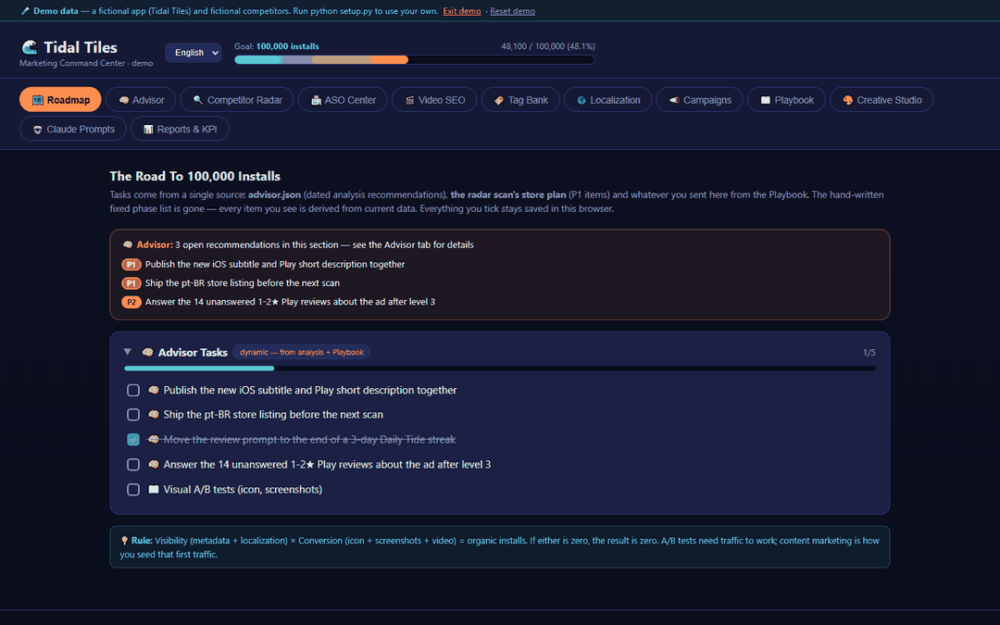
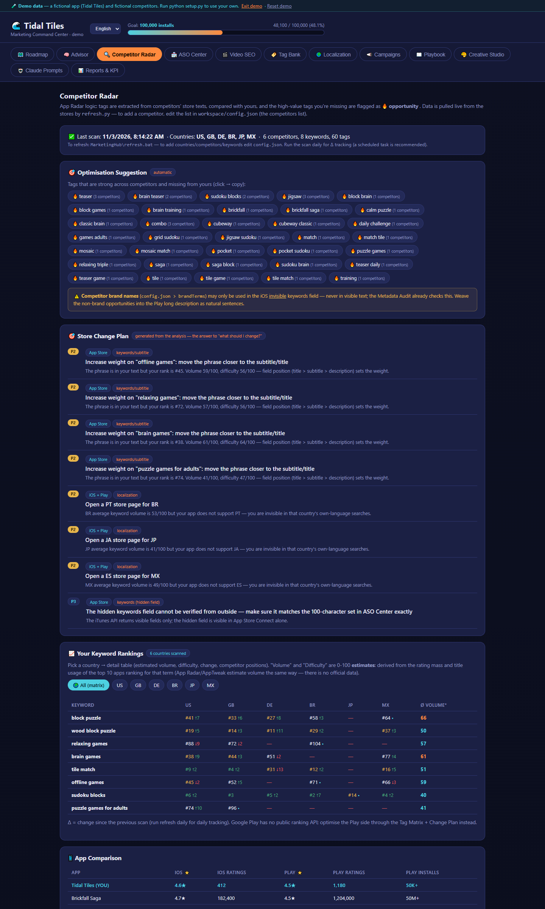
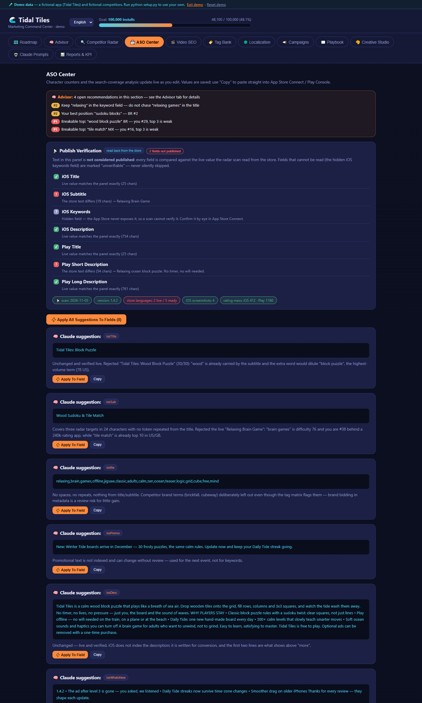
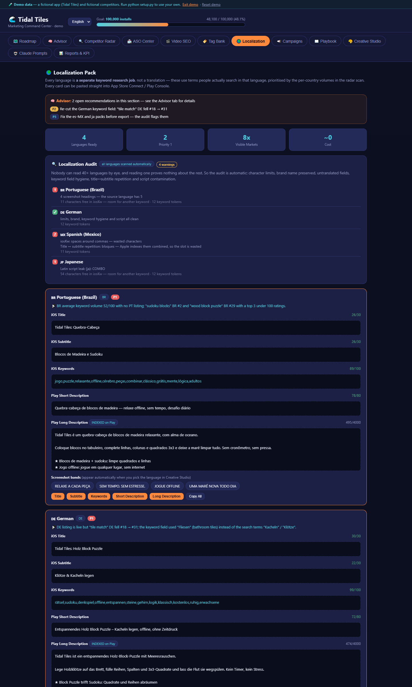
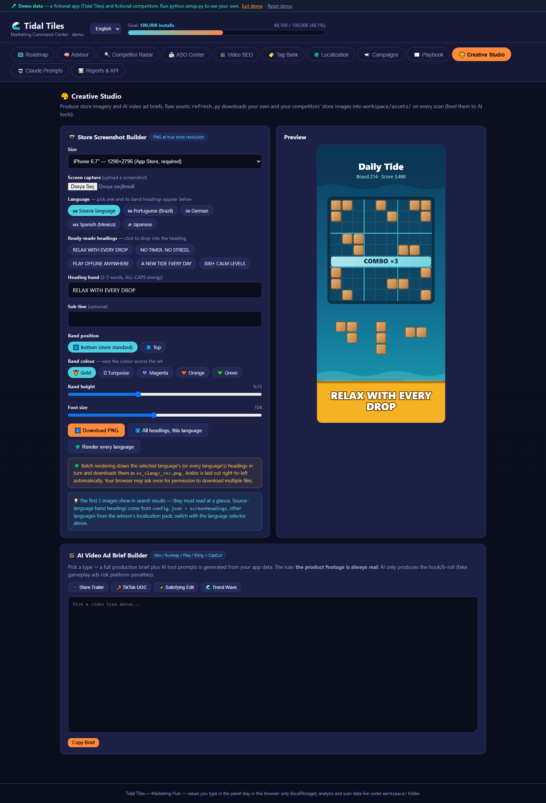

# MarketingHub

**A free, local ASO dashboard for iOS and Android apps. The scanner measures, Claude Code writes the copy, and nothing counts as published until it is read back from the store.**

[](LICENSE)
[](https://www.python.org/)
[](#is-my-data-sent-anywhere)
[](skills/marketinghub/SKILL.md)

[Türkçe README](README.tr.md)



---

## Try the demo in 30 seconds

No config, no scan, no account. The demo opens the panel with a fictional sample app.

```bash
git clone https://github.com/talhasoyludev/aso-marketinghub.git
cd aso-marketinghub
```

| OS | Run |
|---|---|
| Windows | double-click `demo.bat` |
| macOS | `./demo.command` |
| Linux / any | `python -m http.server 8137`, then open <http://localhost:8137/?demo=1> |

## Use it on your own app (3 steps)

1. **Configure.** `python setup.py` creates `workspace/` from the templates and tells you what is missing. Fill in `workspace/config.json`: store IDs, keywords to track, countries, competitors. Every field is documented inside the file.
2. **Scan.** `python refresh.py` reads the public store pages and writes `workspace/data.json`. It takes a few minutes because requests are rate-limited on purpose.
3. **Analyse.** Open the panel with `start.bat` (Windows) or `./start.command` (macOS), or `python -m http.server 8137` anywhere. Then, in Claude Code, from the project folder:

   ```
   do the ASO analysis for my app
   ```

   Claude loads `skills/marketinghub/`, reads the scan and writes `workspace/advisor.json`: store copy, per-market localization packs and dated recommendations. Refresh the panel to see them.

Open the panel through the local server, not by double-clicking `index.html`; a `file://` page cannot read the JSON files.

### Install the skill as a Claude Code plugin

The skill drives the analysis; the scanner and the panel live in the repo, so clone it first. To make the skill available in every Claude Code session:

```
/plugin marketplace add talhasoyludev/aso-marketinghub
/plugin install marketinghub@marketinghub
```

Or with the skills CLI: `npx skills add talhasoyludev/aso-marketinghub`.

---

## Why MarketingHub

Most indie developers do ASO in a spreadsheet, a free trial, or a single chat prompt. MarketingHub is built around a different split: a scanner you can trust for numbers, and Claude for the words, with a method written down so the result is reproducible.

- **Free and local.** MIT licensed. Runs on your machine with Python and a browser. No signup, no account, no API keys.
- **Standard library only.** No `pip install`, no dependency tree to audit.
- **Your data stays with you.** Everything you configure and every scan lands in `workspace/`, which is git-ignored. The only network traffic is to the public store pages being read.
- **History over time.** Every scan appends to a history, so the Reports tab shows trends instead of a single snapshot.
- **Multi-country rankings.** Each tracked keyword is ranked on the App Store in every country you list, with deltas against the previous scan.
- **Competitor tag matrix.** Which words your competitors use, how many put them in their title, and which ones you are missing.
- **Publish verification.** After you paste new metadata into a store console, the next scan reads the live listing back and compares it field by field.
- **Localization audit.** Character limits, brand preservation, untranslated fields, keyword hygiene and mixed scripts, checked for every locale.
- **Claude writes the copy, with a documented method.** The [skill](skills/marketinghub/SKILL.md) defines phases, rules and the exact output schema. Every recommendation has to point at something observable in the scan.

### How it compares

General categories, not specific products. Individual tools vary.

| | MarketingHub | Typical AI ASO skill | Typical paid ASO SaaS |
|---|---|---|---|
| Cost | Free (MIT) | Usually free | Monthly subscription |
| Signup / API keys | None | Often an LLM or data API key | Account required |
| Where your data lives | Your disk | Chat session | Vendor's servers |
| Live store measurements | Yes, scraped from public pages | Usually none; works from what you paste | Yes |
| History across scans | Yes | No | Yes |
| Competitor tag matrix | Yes | Sometimes, per prompt | Usually |
| Publish verification (read-back) | Yes | No | Rarely |
| Localization audit | Yes, rule-based | No | Varies |
| Who writes the copy | Claude, following a documented method | The model, ad hoc | You, or a built-in generator |
| Real search volume | No, estimates only | No | Yes, usually their main value |

If you need real search volume and keyword difficulty from a large panel of data, a paid tool is the right choice. MarketingHub is for the work around those numbers: tracking, competitor coverage, writing, localizing and verifying.

## What the panel gives you

| Tab | What it does |
|---|---|
| **Roadmap** | Tasks generated from the advisor's recommendations and the scanner's store plan. |
| **Advisor** | Two sources: the rule engine (data-driven, every scan) and Claude's dated analyses. |
| **Competitor Radar** | Rankings per country with deltas, competitor comparison, tag matrix, opportunity tags. |
| **ASO Center** | Metadata fields with live character counters, publish verification against the live listing, and an automatic metadata audit. |
| **Video SEO** | YouTube title templates and tag sets built from your scanned keywords. |
| **Tag Bank** | Keyword groups derived from the radar, opportunity tags and per-language sets. |
| **Localization** | Per-market packs plus the automatic audit. |
| **Campaigns** | UTM link builder, campaign log, CPI verdict, and where to look in Firebase. |
| **Playbook** | Growth methods still awaiting a decision. Pruned, not accumulated. |
| **Creative Studio** | Store screenshot renderer (real store resolutions, RTL-aware, batch across all languages) and AI video ad briefs. |
| **Claude Prompts** | Prompt templates filled with your app's own data. |
| **Reports & KPI** | History from every scan, plus optional manual console data. |

| Competitor Radar | ASO Center |
|---|---|
|  |  |
| **Localization** | **Creative Studio** |
|  |  |

### Two principles the tool enforces

- **Nothing frozen.** No hand-written keyword lists, checklists or sample copy live in the code. Every list comes from `config.json`, the scan, or the advisor file.
- **Read back or it didn't happen.** Text in the panel is never reported as published until the scan reads that exact value from the store. Fields that cannot be read, such as the hidden iOS keyword field, are labelled unverifiable rather than skipped.

## Limits, stated plainly

- **Volume and difficulty are estimates.** They are 0-100 scores derived from the rating mass and title usage of the apps ranking for a term. Use them to compare your own phrases, not as search volume.
- **Rankings are App Store only.** Google Play has no public ranking API, so the Play side is optimised through the tag matrix and the change plan instead of positions.
- **Scanning is slow on purpose.** Requests are spaced out (`rateLimitSeconds`, default 3) to stay within the public endpoints' limits. More keywords times more countries means a longer scan.
- **The iOS keyword field cannot be verified.** Apple does not expose it publicly; the panel marks it unverifiable.
- **Claude Code is needed for the copy.** Without it you still get the scanner, the rule engine and the panel, but `advisor.json` stays empty.

## FAQ

### Is it free?
Yes. MIT licensed, no paid tier, no hosted version. Claude Code itself requires a Claude plan; MarketingHub adds no cost on top.

### Do I need Claude Code?
For the scanner, rule engine and panel, no: Python and a browser are enough. For the store copy, localization packs and dated analyses, yes. Those are written by Claude following the skill in `skills/marketinghub/`.

### Does it work for Android only, or iOS only?
Yes to both. Set `iosId` or `playId` in the config and leave the other empty. App Store keyword rankings need an iOS app; Play listings get the tag matrix, metadata audit, localization audit and publish verification.

### Is my data sent anywhere?
No. The scanner sends requests to the public App Store and Google Play pages and APIs it reads, and nowhere else. Your config, scans and analyses stay in `workspace/` on your disk, which git ignores. When you run the analysis, Claude Code reads those files the same way it reads any project you open with it.

### Will Apple or Google ban me for scraping?
MarketingHub reads public, logged-out store pages and the public iTunes search and lookup endpoints, at a low rate, with no account involved, so there is nothing tied to your developer account. That said, you are responsible for using it in line with each store's terms of service. Keep the rate limit at its default or higher, and track a reasonable number of keywords and countries.

### Can I track more than one app?
Yes. Add another block under `apps` in `config.json` and switch `activeApp`.

## Layout

```
index.html              the panel (12 tabs), reads the JSON files below
refresh.py              store scanner + rule engine → workspace/data.json
setup.py                first-run setup and health check (--check to only report)
export_metadata.py      advisor.json → per-locale, store-ready text files
demo.bat / demo.command open the panel with a fictional sample app
start.bat / start.command  open the panel with your own data
i18n/                   panel languages (en, tr); add your own
templates/              seed files copied into workspace/ on first run
skills/marketinghub/    the Claude Code skill: how the analysis is produced
docs/                   media and launch notes
workspace/              YOUR data: git-ignored, never committed
```

`workspace/` holds `config.json`, `data.json`, `advisor.json`, `playbook.json`, downloaded store assets and the metadata export. Fork the repo and your analysis stays private.

## Language

The panel ships in English and Turkish. Pick one from the selector in the header; the choice is stored per browser and defaults to `config.json > lang`. The scanner and setup scripts print in English by default and in Turkish when `lang` is `"tr"`; rule-engine recommendations follow the same setting.

To add a language: copy `i18n/en.json` (the `ui` keys are the panel's Turkish source strings), replace the values with your translation, translate `prompts` and `briefs`, save it as `i18n/<code>.json`, and add the code to `LANGS` in `index.html`. A missing key shows the source string instead of breaking.

## Requirements

- Python 3.9+ (standard library only)
- A modern browser
- Claude Code for the analysis phases

## Contributing

Issues and pull requests are welcome, especially new panel languages, scanner fixes when a store page changes, and clearer audit rules. Read [CONTRIBUTING.md](CONTRIBUTING.md) first; changes are tracked in [CHANGELOG.md](CHANGELOG.md).

If MarketingHub is useful to you, a star helps other indie developers find it.

[](https://star-history.com/#talhasoyludev/aso-marketinghub&Date)

## License

MIT, see [LICENSE](LICENSE). Built by [Talha Soylu](https://github.com/talhasoyludev).
