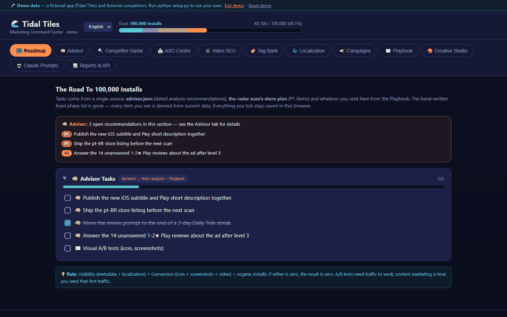
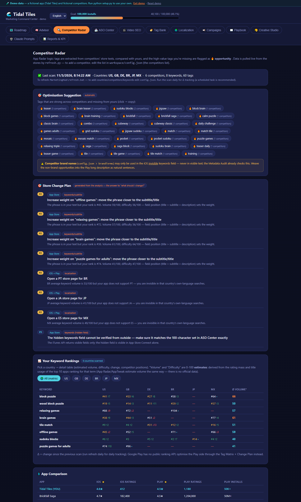
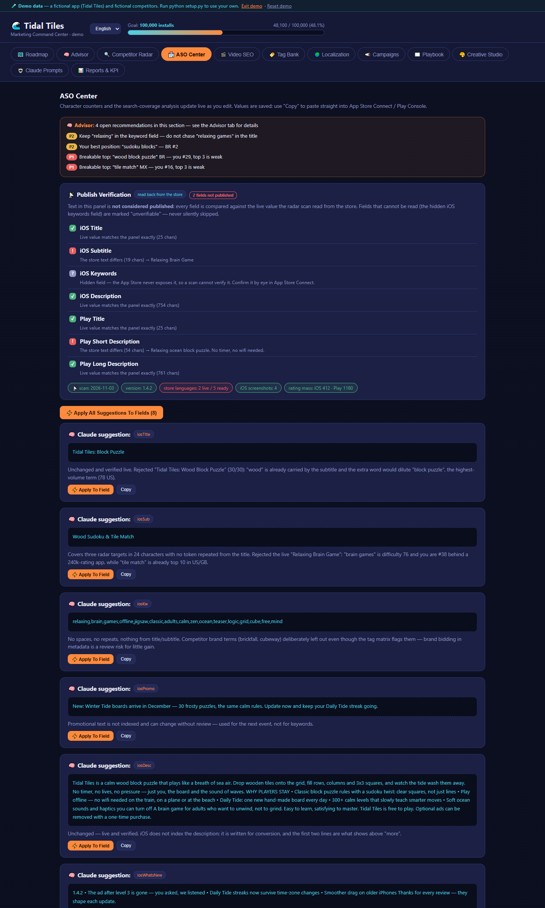
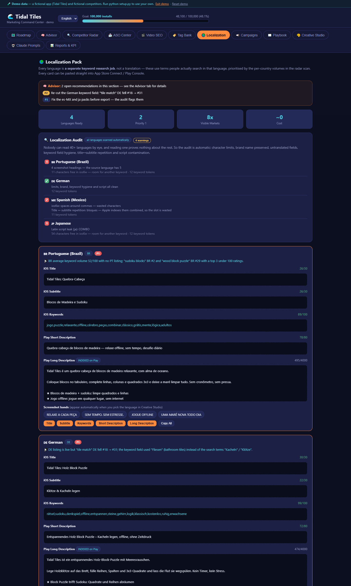
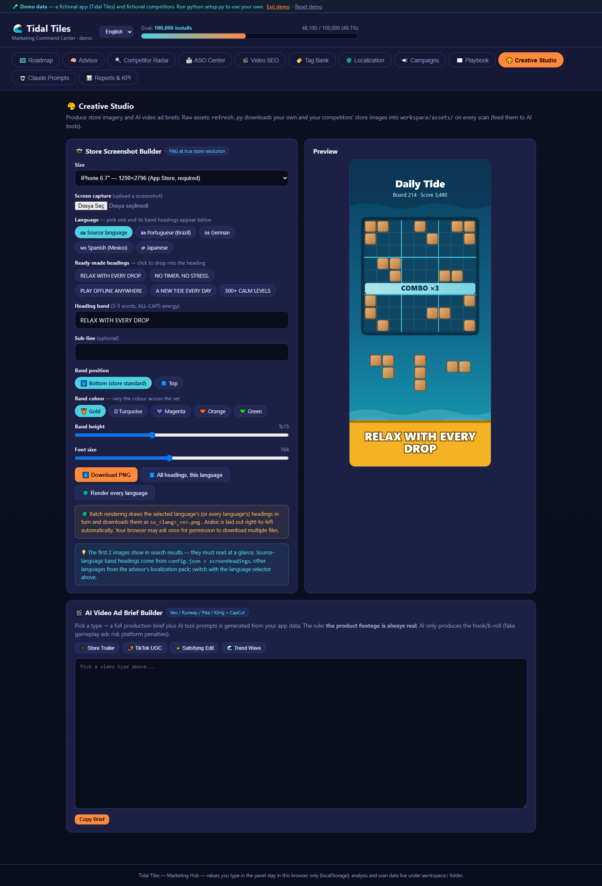

# MarketingHub

**iOS ve Android uygulamaları için ücretsiz, yerelde çalışan bir ASO paneli. Ölçümü tarayıcı yapar, mağaza metnini Claude Code yazar; mağazadan geri okunmayan hiçbir şey "yayında" sayılmaz.**

[](LICENSE)
[](https://www.python.org/)
[](#verilerim-bir-yere-gönderiliyor-mu)
[](skills/marketinghub/SKILL.md)

[English README](README.md) (ana belge)



---

## 30 saniyede demoyu dene

Ayar yok, tarama yok, hesap yok. Demo, paneli kurgusal bir örnek uygulamayla açar.

```bash
git clone https://github.com/talhasoyludev/aso-marketinghub.git
cd aso-marketinghub
```

| İşletim sistemi | Çalıştır |
|---|---|
| Windows | `demo.bat` dosyasına çift tıkla |
| macOS | `./demo.command` |
| Linux / diğer | `python -m http.server 8137`, sonra <http://localhost:8137/?demo=1> adresini aç |

## Kendi uygulamanda kullan (3 adım)

1. **Ayarla.** `python setup.py`, `workspace/` klasörünü şablonlardan oluşturur ve eksikleri söyler. `workspace/config.json` dosyasını doldur: mağaza kimlikleri, takip edilecek kelimeler, ülkeler, rakipler. Her alanın açıklaması dosyanın içinde.
2. **Tara.** `python refresh.py` herkese açık mağaza sayfalarını okur ve `workspace/data.json` dosyasını yazar. İstekler bilerek aralıklı gönderildiği için birkaç dakika sürer.
3. **Analiz ettir.** Paneli `start.bat` (Windows) ya da `./start.command` (macOS) ile, her yerde de `python -m http.server 8137` ile aç. Sonra proje klasöründe Claude Code'a şunu yaz:

   ```
   bu uygulamanın ASO analizini yap
   ```

   Claude `skills/marketinghub/` skill'ini yükler, taramayı okur ve `workspace/advisor.json` dosyasına mağaza metinlerini, pazar bazlı lokalizasyon paketlerini ve tarihli önerileri yazar. Paneli yenilediğinde hepsi görünür.

Paneli `index.html` dosyasına çift tıklayarak değil, yerel sunucu üzerinden aç; `file://` ile açılan sayfa JSON dosyalarını okuyamaz.

### Skill'i Claude Code eklentisi olarak kur

Analizi skill yönetir; tarayıcı ve panel ise repoda durur, yani önce repoyu klonla. Skill'in her Claude Code oturumunda hazır olması için:

```
/plugin marketplace add talhasoyludev/aso-marketinghub
/plugin install marketinghub@marketinghub
```

Ya da skills CLI ile: `npx skills add talhasoyludev/aso-marketinghub`.

---

## Neden MarketingHub

Bağımsız geliştiricilerin çoğu ASO'yu bir tabloda, bir deneme sürümünde ya da tek bir sohbet mesajında yapıyor. MarketingHub işi farklı bölüyor: sayılar için güvenebileceğin bir tarayıcı, kelimeler için Claude ve sonucu tekrarlanabilir kılan yazılı bir yöntem.

- **Ücretsiz ve yerel.** MIT lisanslı. Python ve tarayıcıyla kendi makinende çalışır. Üyelik, hesap ya da API anahtarı yok.
- **Yalnızca standart kütüphane.** `pip install` yok, denetlenecek bağımlılık ağacı yok.
- **Verin sende kalır.** Ayarların ve her tarama `workspace/` altına yazılır; bu klasör git'e girmez. Tek ağ trafiği, okunan herkese açık mağaza sayfalarınadır.
- **Zaman içindeki geçmiş.** Her tarama geçmişe eklenir; Rapor sekmesi tek bir anı değil, gidişatı gösterir.
- **Çok ülkeli sıralama.** Takip ettiğin her kelime, listelediğin her ülkede App Store'da sıralanır ve bir önceki taramayla karşılaştırılır.
- **Rakip etiket matrisi.** Rakiplerin hangi kelimeleri kullandığı, kaçının bunları başlığa koyduğu ve hangilerinin sende eksik olduğu.
- **Yayın doğrulama.** Yeni metni mağaza konsoluna yapıştırdıktan sonraki taramada canlı sayfa geri okunur ve alan alan karşılaştırılır.
- **Lokalizasyon denetimi.** Karakter limitleri, marka korunması, çevrilmemiş alanlar, keyword hijyeni ve karışık alfabe; her dil için ayrı ayrı.
- **Metni Claude yazar, yöntemi belgelidir.** [Skill](skills/marketinghub/SKILL.md) fazları, kuralları ve çıktının tam şemasını tanımlar. Her öneri taramada gözlenebilen bir şeye dayanmak zorundadır.

### Karşılaştırma

Belirli ürünler değil, genel kategoriler. Tek tek araçlar farklılık gösterebilir.

| | MarketingHub | Tipik AI ASO skill'i | Tipik ücretli ASO SaaS |
|---|---|---|---|
| Maliyet | Ücretsiz (MIT) | Genelde ücretsiz | Aylık abonelik |
| Üyelik / API anahtarı | Yok | Çoğu zaman LLM ya da veri API anahtarı | Hesap gerekir |
| Veri nerede durur | Senin diskinde | Sohbet oturumunda | Sağlayıcının sunucularında |
| Canlı mağaza ölçümü | Var, herkese açık sayfalardan | Genelde yok; yapıştırdığın metinle çalışır | Var |
| Taramalar arası geçmiş | Var | Yok | Var |
| Rakip etiket matrisi | Var | Bazen, istek başına | Genelde var |
| Yayın doğrulama (geri okuma) | Var | Yok | Nadiren |
| Lokalizasyon denetimi | Var, kural tabanlı | Yok | Değişir |
| Metni kim yazar | Belgeli yönteme uyan Claude | Model, plansız | Sen ya da yerleşik bir üretici |
| Gerçek arama hacmi | Yok, yalnızca tahmin | Yok | Var, çoğu zaman asıl değerleri bu |

Büyük bir veri panelinden gelen gerçek arama hacmi ve zorluk skoru gerekiyorsa ücretli bir araç doğru tercih. MarketingHub bu sayıların etrafındaki işler için: takip, rakip kapsamı, yazım, lokalizasyon ve doğrulama.

## Panel ne veriyor

| Sekme | Ne yapar |
|---|---|
| **Yol Haritası** | Danışman önerilerinden ve tarayıcının mağaza planından üretilen görevler. |
| **Danışman** | İki kaynak: kural motoru (her taramada, veriden) ve Claude'un tarihli analizleri. |
| **Rakip Radar** | Ülke bazlı sıralamalar ve değişimler, rakip karşılaştırması, etiket matrisi, fırsat etiketleri. |
| **ASO Merkezi** | Canlı karakter sayaçlı metadata alanları, canlı sayfaya karşı yayın doğrulama ve otomatik metadata denetimi. |
| **Video SEO** | Taranan kelimelerden üretilen YouTube başlık şablonları ve tag setleri. |
| **Tag Bankası** | Radardan, fırsat etiketlerinden ve dil setlerinden türeyen kelime grupları. |
| **Lokalizasyon** | Pazar bazlı paketler ve otomatik denetim. |
| **Kampanya** | UTM link üretici, kampanya kaydı, CPI yorumu ve Firebase'de nereye bakılacağı. |
| **Playbook** | Hâlâ karar bekleyen büyütme yöntemleri. Biriktirilmez, budanır. |
| **Kreatif Stüdyo** | Mağaza görseli üretici (gerçek mağaza çözünürlükleri, RTL uyumlu, tüm dillerde toplu) ve AI video reklam brief'leri. |
| **Claude Desteği** | Kendi uygulamanın verisiyle doldurulmuş prompt şablonları. |
| **Rapor & KPI** | Her taramadan gelen geçmiş ve isteğe bağlı elle girilen konsol verisi. |

| Rakip Radar | ASO Merkezi |
|---|---|
|  |  |
| **Lokalizasyon** | **Kreatif Stüdyo** |
|  |  |

### Aracın kendisinin uyguladığı iki ilke

- **Donmuş içerik yok.** Kodda elle yazılmış kelime listesi, kontrol listesi ya da örnek metin durmaz. Her liste `config.json`'dan, taramadan ya da advisor dosyasından gelir.
- **Geri okunmadıysa yayınlanmamıştır.** Paneldeki bir metin, tarama o değeri mağazadan birebir okuyana kadar "yayında" sayılmaz. Okunamayan alanlar (iOS'un gizli keyword alanı gibi) atlanmaz, "doğrulanamaz" diye işaretlenir.

## Sınırlar, açıkça

- **Hacim ve zorluk tahmindir.** Bir terimde sıralanan uygulamaların puan sayısından ve başlık kullanımından türetilen 0-100 skorlardır. Kendi kelime öbeklerini kıyaslamak için kullan, arama hacmi diye okuma.
- **Sıralama yalnızca App Store'da.** Google Play'in herkese açık bir sıralama API'si yok; Play tarafı sıralama yerine etiket matrisi ve değişiklik planı üzerinden optimize edilir.
- **Tarama bilerek yavaş.** İstekler herkese açık uç noktaların sınırları içinde kalmak için aralıklı gönderilir (`rateLimitSeconds`, varsayılan 3). Kelime sayısı çarpı ülke sayısı arttıkça tarama uzar.
- **iOS keyword alanı doğrulanamaz.** Apple bu alanı dışarıya açmaz; panel onu "doğrulanamaz" diye gösterir.
- **Metin için Claude Code gerekir.** O olmadan da tarayıcı, kural motoru ve panel çalışır; ama `advisor.json` boş kalır.

## Sık sorulanlar

### Ücretsiz mi?
Evet. MIT lisanslı; ücretli sürümü ya da barındırılan bir versiyonu yok. Claude Code'un kendisi bir Claude planı gerektirir; MarketingHub bunun üstüne maliyet eklemez.

### Claude Code şart mı?
Tarayıcı, kural motoru ve panel için hayır; Python ve tarayıcı yeter. Mağaza metinleri, lokalizasyon paketleri ve tarihli analizler için evet. Bunları `skills/marketinghub/` içindeki skill'e uyan Claude yazar.

### Yalnızca Android ya da yalnızca iOS uygulamasıyla çalışır mı?
İkisi de olur. Ayarda `iosId` ya da `playId` alanını doldur, diğerini boş bırak. App Store kelime sıralaması için iOS uygulaması gerekir; Play sayfaları için etiket matrisi, metadata denetimi, lokalizasyon denetimi ve yayın doğrulama çalışır.

### Verilerim bir yere gönderiliyor mu?
Hayır. Tarayıcı yalnızca okuduğu herkese açık App Store ve Google Play sayfalarına ve uç noktalarına istek gönderir, başka hiçbir yere değil. Ayarların, taramaların ve analizlerin diskindeki `workspace/` klasöründe durur ve git'e girmez. Analizi çalıştırdığında Claude Code bu dosyaları, açtığın herhangi bir projedeki dosyaları okuduğu gibi okur.

### Apple ya da Google tarama yüzünden beni engeller mi?
MarketingHub oturum açılmamış, herkese açık mağaza sayfalarını ve herkese açık iTunes arama/lookup uç noktalarını düşük hızda okur; işin içinde hesap olmadığı için geliştirici hesabınla bir bağı yoktur. Yine de aracı her mağazanın kullanım koşullarına uygun kullanmak senin sorumluluğunda. Hız sınırını varsayılanda ya da daha yüksekte tut, makul sayıda kelime ve ülke takip et.

### Birden fazla uygulama takip edebilir miyim?
Evet. `config.json` içinde `apps` altına yeni bir blok ekle ve `activeApp` değerini değiştir.

## Dosya düzeni

```
index.html              panel (12 sekme), aşağıdaki JSON'ları okur
refresh.py              mağaza tarayıcı + kural motoru → workspace/data.json
setup.py                ilk kurulum ve sağlık kontrolü (--check yalnızca raporlar)
export_metadata.py      advisor.json → dil dil, mağazaya girilebilir metin dosyaları
demo.bat / demo.command paneli kurgusal bir örnek uygulamayla açar
start.bat / start.command  paneli kendi verinle açar
i18n/                   panel dilleri (en, tr); kendi dilini ekleyebilirsin
templates/              ilk çalıştırmada workspace/'e kopyalanan şablonlar
skills/marketinghub/    Claude Code skill'i: analizin nasıl üretildiği
docs/                   görseller ve lansman notları
workspace/              SENİN verin: git'e girmez, paylaşılmaz
```

`workspace/` altında `config.json`, `data.json`, `advisor.json`, `playbook.json`, indirilen mağaza görselleri ve metadata dışa aktarımı durur. Repoyu fork'la, analizin sende kalsın.

## Dil

Panel İngilizce ve Türkçe gelir. Başlıktaki seçiciden değiştirilir; seçim tarayıcıda saklanır, varsayılanı `config.json > lang`. Tarayıcı ve kurulum betikleri varsayılan olarak İngilizce, `lang` değeri `"tr"` olduğunda Türkçe yazar; kural motorunun önerileri de aynı ayarı izler.

Yeni dil eklemek için: `i18n/en.json` dosyasını kopyala (`ui` anahtarları panelin Türkçe kaynak metinleridir), değerleri kendi çevirinle değiştir, `prompts` ve `briefs` bölümlerini çevir, `i18n/<kod>.json` olarak kaydet ve kodu `index.html` içindeki `LANGS` listesine ekle. Sözlükte olmayan bir anahtar bozulmaz, kaynak metin görünür.

## Gereksinimler

- Python 3.9+ (yalnızca standart kütüphane)
- Güncel bir tarayıcı
- Analiz fazları için Claude Code

## Katkı

Issue ve pull request'ler açık; özellikle yeni panel dilleri, bir mağaza sayfası değiştiğinde tarayıcı düzeltmeleri ve daha net denetim kuralları. Önce [CONTRIBUTING.md](CONTRIBUTING.md) dosyasını oku; değişiklikler [CHANGELOG.md](CHANGELOG.md) içinde tutulur.

MarketingHub işine yaradıysa bir yıldız, başka bağımsız geliştiricilerin onu bulmasına yardım eder.

[](https://star-history.com/#talhasoyludev/aso-marketinghub&Date)

## Lisans

MIT, bkz. [LICENSE](LICENSE). Geliştiren: [Talha Soylu](https://github.com/talhasoyludev).
